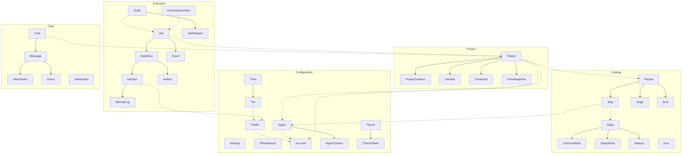

# Data model

Contexts, aggregates and entities of <PE/CORE>.

Solid arrow: part of the same aggregate. Dashed arrow: reference by id to another aggregate. The first box of each group is the aggregate root.

## Aggregates

**Configuration**

- `Settings`: user name, limits, services runtime, free disk, merge check, projects folder, protected mode.
- `UiPreference`: one UI preference by name.
- `Account`: model (harness, provider, login), forge (Git hosting, commit author) or service (tracker).
- `Profile`: account, model, effort.
- `Tiers`: for each tier (frontier, strong, standard, cheap) an ordered list of profiles.
- `Agent`: node card, Project Manager or Assistant, with account, model, effort, compaction and its context.
- `Theme`: colour tokens.

**Catalog**

- `Node`: agent, command, human or repository template, with its rules and its prompt or script (sidecar).
- `Recipe`: steps, edges between outcomes, ends, CI and layout.
- `Icon`: SVG by name.

**Project**

- `Project`: repository, base branch, recipes, Project Manager, tracker, variables, credentials, knowledge, creation step.

**Execution**

- `Job`: request, recipe snapshot, Git positions and state; contains node runs, their attempts, logs and artifacts. Its events are the source of truth.
- `Order`: a tracker ticket and the jobs planned from it.
- `HumanQueueItem`: a decision waiting for the user.

**Chat**

- `Chat`: Assistant or Project Manager conversation, with messages, attachments and actions.
- `Notification`: one message to the user.

## Storage

| Context | Where |
|---|---|
| Configuration, Catalog, Chat | `PECORE_HOME/chats.db` |
| Project, Execution, project copy of the Catalog | `PECORE_HOME/projects/<id>/pecore.db` |
| Connectors | `resources/connectors/*.json` |
| Logins, node tests | memory only |

The Zod schemas are in `packages/schemas/src/`. Theme, Icon, Chat, Notification and the Execution rows have no Zod schema of their own: Execution is typed through its events (`EventBody`).
